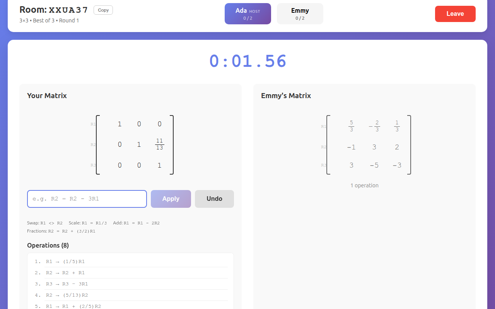

# RREF Battle

Two players get the same matrix and race to put it into reduced row echelon form, typing elementary row operations as fast as they can. First to finish takes the round. There is also a solo practice mode against the clock.



## Playing

1. One player creates a room, picks a matrix size (3×3, 4×4, 5×5 or random) and a match length (single battle, best of 3, best of 5), and shares the six-character room code.
2. The other player joins with the code. Both ready up and the host starts the round.
3. A three-second countdown shows the matrix. It cannot be touched until the countdown ends.
4. Type row operations. You can see your opponent's matrix change as they work.
5. The first player whose matrix is in RREF wins the round.

### Commands

Rows are numbered from 1. Case and spaces are ignored.

| Operation | Examples |
|---|---|
| Swap two rows | `R1 <> R2`, `R1 <-> R2` |
| Scale a row | `R1 = 3R1`, `R1 = R1/3`, `R1 = (2/3)R1`, `R1 = -R1`, `R1 = 0.5R1` |
| Add a multiple of another row | `R1 = R1 + 2R2`, `R1 = R1 - (3/2)R2`, `R1 = 2R2 + R1` |

The target row can also go last (`R1 + 2R2 -> R1`), and `*` is optional (`3R2` and `3*R2` are the same).

Only the three elementary operations are accepted. `R1 = R2` (overwrites a row), `R1 = 2R1 + R2` (two operations at once) and `R1 = 0R1` are rejected with a message saying why. Undo reverts your last operation.

## How it works

```
shared/   Game engine and wire protocol, used by both sides
  fraction.ts   exact rational numbers on bigint
  matrix.ts     row operations, undo, RREF check, Gauss-Jordan solver
  parser.ts     typed command -> row operation
  protocol.ts   room snapshot and socket event types
server/   Node, Express, Socket.IO
  src/room/Room.ts          the rules of a match, with no networking
  src/room/RoomManager.ts   room codes and who is in which room
  src/app.ts                socket events -> Room calls -> broadcast
client/   React, Vite
```

- **Exact arithmetic.** Entries are fractions of `bigint`s, never floats. `R1 = R1/3` followed by `R1 = 3R1` gives back exactly what you started with, and "is this RREF?" is an equality check with no tolerance.
- **The server is authoritative.** Clients send the text the player typed; the server parses it, applies it and broadcasts a full snapshot of the room. A client cannot claim a win, move during the countdown, or act after the round is decided.
- **One engine.** Practice mode runs the same `shared/` code in the browser that the server runs for multiplayer, so the two cannot disagree about what a command means.
- **Untrusted input.** Every socket payload is validated before use; malformed events are ignored rather than crashing the process.

A room moves through `waiting → countdown → playing → round-over → waiting …` until someone has enough wins, then `finished`. If a player leaves or disconnects mid-match, the match is abandoned, the room returns to `waiting`, and the remaining player becomes host.

## Running locally

Requires Node 20 or newer.

```bash
npm run setup          # installs server/ and client/ dependencies

# terminal 1: game server on http://localhost:3001
npm run dev --prefix server

# terminal 2: client on http://localhost:5173
npm run dev --prefix client
```

Open http://localhost:5173 in two tabs to play against yourself.

To run it the way it is deployed, as a single process that serves the built client:

```bash
npm run build
npm start              # http://localhost:3001
```

### Configuration

| Variable | Where | Purpose |
|---|---|---|
| `PORT` | server | Port to listen on (default `3001`) |
| `CLIENT_ORIGINS` | server | Comma-separated origins allowed to connect, when the client is hosted on a different domain |
| `CLIENT_DIST` | server | Built client to serve (default `../client/dist`) |
| `VITE_SERVER_URL` | client build | Game server URL, when it is not the origin serving the client |

`render.yaml` describes a single-service deployment on Render.

## Tests

```bash
npm test               # engine, parser, room rules and full matches over real sockets
npm run check          # typecheck, tests, lint and production build (what CI runs)
```

The suite includes property-style tests: random sequences of row operations must undo exactly and must never change a matrix's reduced form.

## Limitations

- Rooms live in memory, so a server restart ends every match.
- A dropped connection removes the player from the room; there is no rejoin.
- Matches are two players only.

## License

[MIT](LICENSE)
